# CYBERPUNK MEGAPOLIS — Web-Swing Edition

纯前端第三人称 3D 摆荡游戏。Three.js r169 **本地引入**，程序化生成的赛博都市，跑、跳、蛛丝摆荡、收绳、俯冲、飞掠、墙跑、墙跳全部可连续游玩。

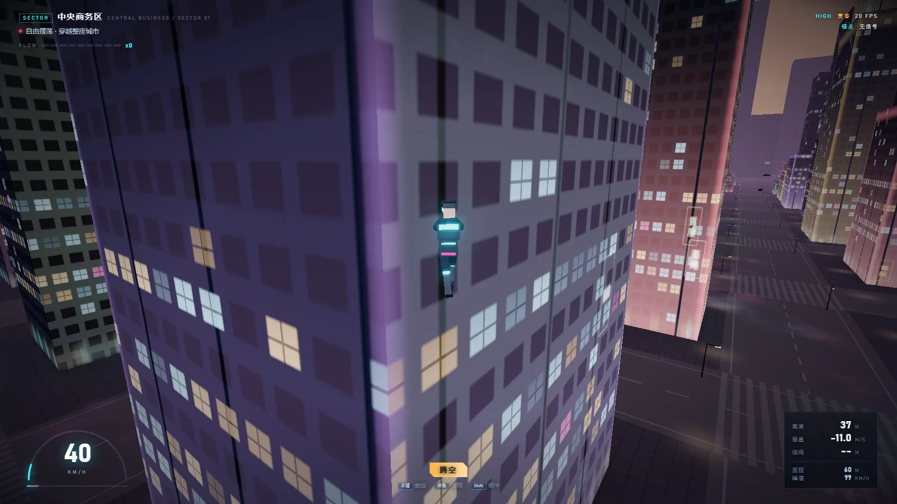

**无 CDN · 无构建步骤 · 无 npm 运行时依赖 · 断网可玩** ｜ 23 项单测通过 · 冒烟测试 0 错误 0 失败请求

---

## 快速开始

```bash
npm start          # 打开 http://127.0.0.1:5173/
```

不需要 `npm install`——运行时只用到 `vendor/three/` 和 `assets/textures/`。等加载条走完 → 选角色 → ENTER THE CITY，首次点击画面会锁定鼠标。

必须走 HTTP：ES Module 与 importmap 在 `file://` 下会被 CORS 拦住。

## 截图

| | |
| --- | --- |
| 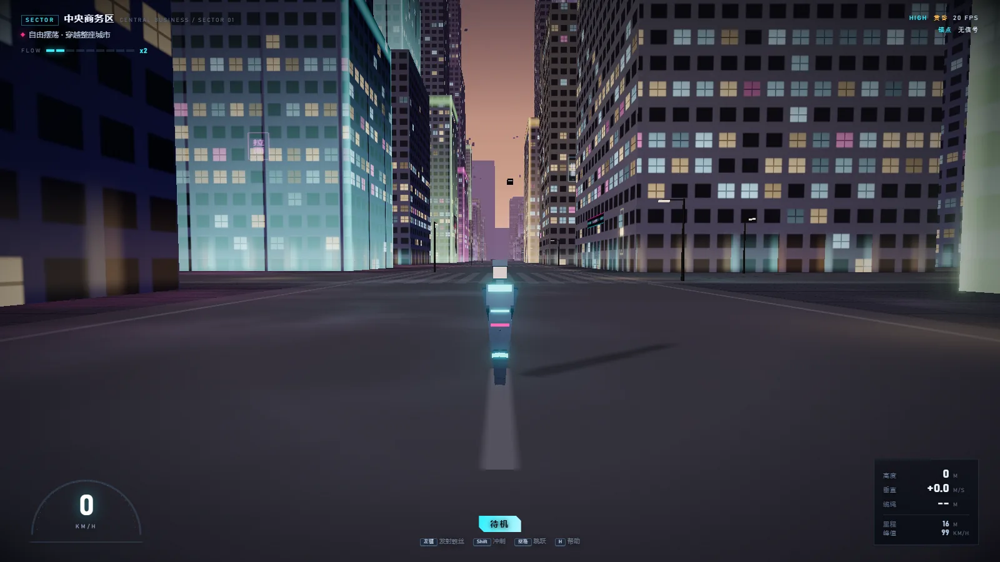 | 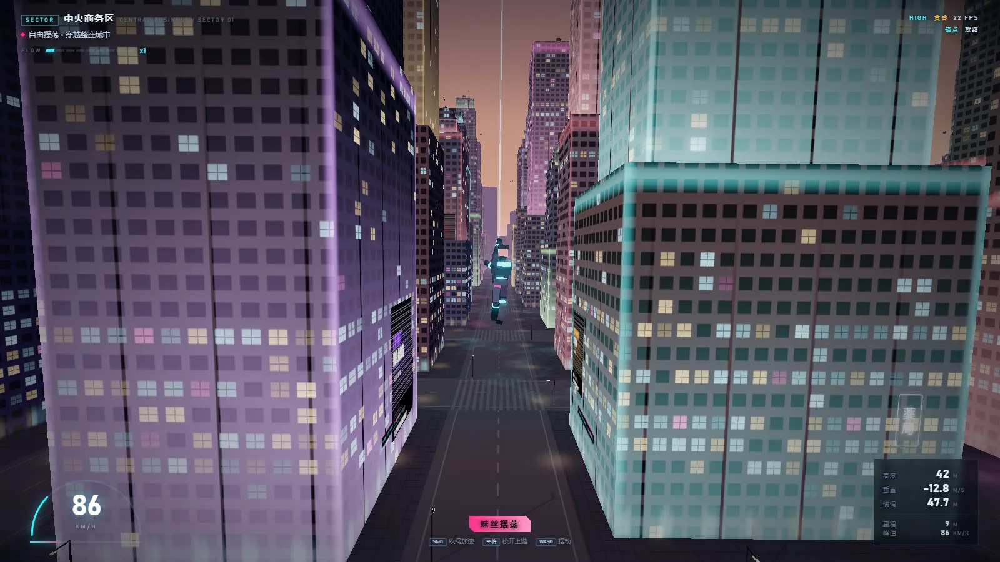 |
| 街道峡谷 —— 湿地面反射霓虹，窗灯按楼层随机亮灭 | 蛛丝摆荡 —— 绳长约束 + 收绳加速，蛛丝从右手骨骼连到挂点 |
| 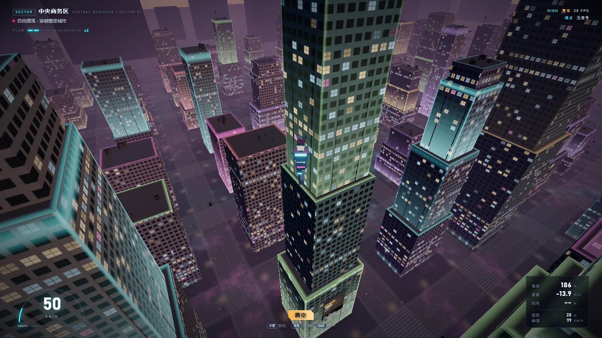 | 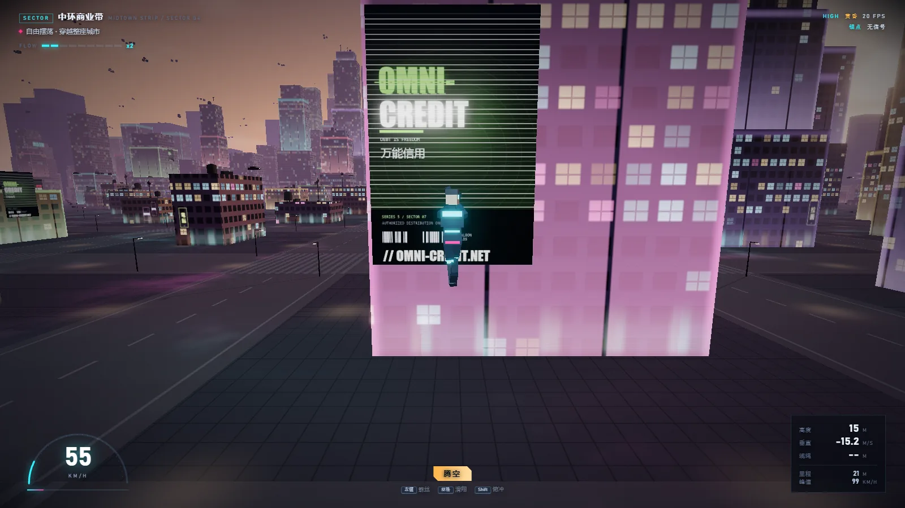 |
| 高空俯瞰 —— 342 栋建筑、6187 个挂点、分块 LOD | 广告墙 —— 程序化生成的招牌图集与滚动字幕 |
| 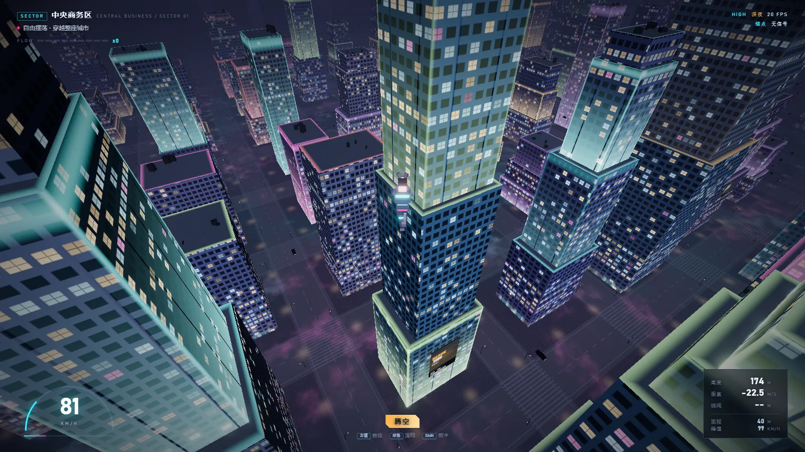 | 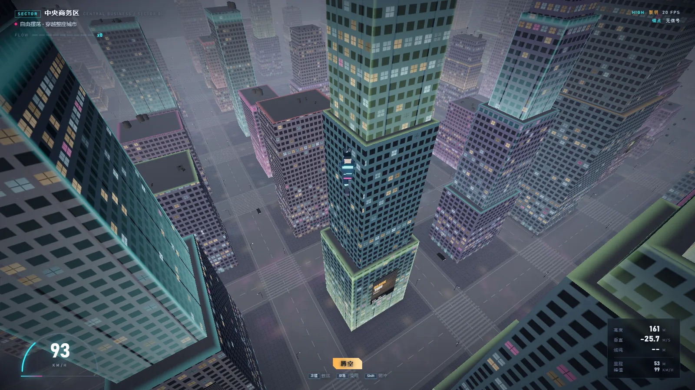 |
| 深夜预设 —— 泛光拉满，店面橱窗分间点亮 | 黎明预设 —— 冷调天空 + 低角度平行光 |

<details>
<summary>更多（菜单 / 暂停 / 帮助）</summary>

| | |
| --- | --- |
| 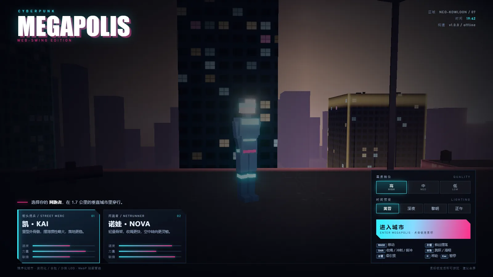 | 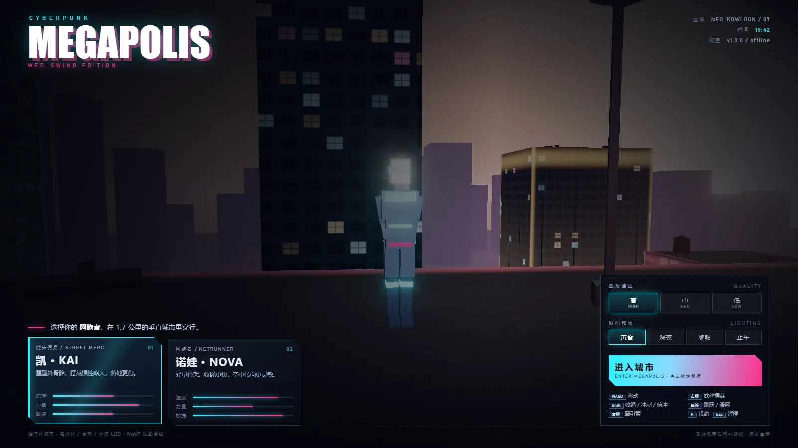 |
| 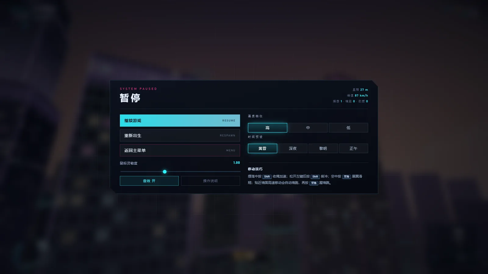 | 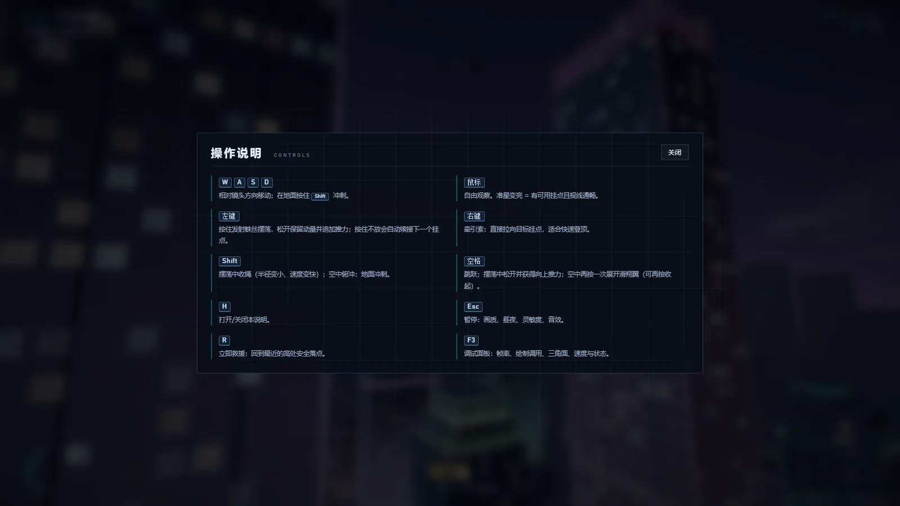 |

</details>

## 操作

| 输入 | 动作 |
| --- | --- |
| `W A S D` / 方向键 | 移动（贴地跑 / 空中转向） |
| 鼠标移动 | 视角 |
| 鼠标左键（按住） | 发射蛛丝并摆荡；松开瞬间有额外推进 |
| `Shift`（摆荡中） | 收绳：半径变小、速度变快 |
| `Shift`（空中） | 俯冲；临近地面松开可拉平 |
| `空格` | 跳跃 / 空中展开滑翔翼 / 墙跑时蹬墙跳 |
| 鼠标右键 | 牵引索：对准目标点快速拉近 |
| `R` | 回到最近的安全屋顶 |
| `Esc` | 暂停（画质、昼夜、灵敏度、音量） |
| `H` | 帮助面板 |
| `F3` | 调试数据面板 |

摆荡手感的关键：**点越远摆得越久，越近越急**。挂点准星变亮表示视线通畅，变红表示被遮挡；没挂住时会有明确的"拒绝"音效与提示。

## 两条角色线

- **凯 · KAI**（街头佣兵）：重型外骨骼，惯性大、落地稳，转向略钝。
- **诺娃 · NOVA**（网跑者）：轻量骨架，收绳快 12%、空中转向更灵敏。

角色差异只影响 `agilityMul`（收绳速率/转向）与身高肩宽缩放，物理内核完全一致。

## 技术要点

**数据驱动城市。** `CityPlanner` 是纯数据层，不 import three，可在 Node 里单测。它按 seed 生成建筑体块（含退台）、碰撞盒、挂点、街道装置、霓虹招牌、海报、滚动字幕、空中连廊、飞行车道、地铁线与站点、出生点、以及给地面着色器用的 512² 高度图。`CityBuilder` 只负责把这些数据变成 GPU 资源。

**单 draw call 的建筑。** 全部建筑用一个 `InstancedBufferGeometry` 渲染，窗格、店面、霓虹边线、顶部灯带全部在 GLSL 里按实例属性（尺寸、随机种子、片区色）算出来，不贴图、不额外几何。近处有窗灯亮灭与玻璃吸光，远处自动退化为低细节。

**合批与 LOD。** 屋顶装置、街道设施、海报按片区 `mergeGeometries` 合批；装置按 4×4 分块做近/远两级切换；交通与地铁是实例化网格，到站减速。

**摆荡物理。** 刚性绳长约束：每帧把位置投影回球面（`projectToRope`）并消掉径向速度，再叠加泵动、转向与收绳。低速时会自动补一点切向力，避免"吊在半空不动"。蛛丝的可视化在 `src/player/WebLine.js`：从右手骨骼的世界坐标连到挂点，细芯线 + 外层辉光，命中瞬间在锚点爆一圈光斑；牵引索用洋红色区分。

**高速防穿模。** 速度越高子步越多，每步用竖直胶囊 vs AABB 做迭代解算（最多 3 次），撞墙时把速度投影到墙面切向，不会穿楼也不会粘墙。宽相位用空间哈希。

**电影相机。** 速度驱动 FOV、视距与侧倾，带前瞻偏移、射线遮挡自动回缩、落地/撞击震屏。菜单里是环绕镜头，进游戏有一段开场推进。

**画质三档。** High / Medium / Low 分别控制 DPR、阴影、泛光、装置密度、车辆数量、纹理尺寸。切换即时生效，不用重载。

**昼夜四预设。** 黄昏 / 深夜 / 黎明 / 正午，实时改天空穹顶 uniform、雾色、平行光与点光，城市不用重建。

**真实进度。** 加载进度按 6 个阶段加权（渲染器 → 纹理 → 规划 → 构建 → 装配 → 预热编译），进度条跟的是真活儿，不是假动画。

**离线资产。** `tools/gen_textures.py` 用 PIL + 系统字体离线生成 12 张 WebP（海报 6 张、霓虹招牌图集、滚动字幕、立面细节、沥青、光斑、全息），约 420KB，产物提交在 `assets/textures/`。音频全部是 WebAudio 实时合成，没有音频文件。

## 目录

```
index.html            结构 + importmap
server.js             零依赖静态服务器
src/
  config.js           世界 / 画质 / 昼夜 / 手感 / 按键 / 角色
  main.js             启动、阶段进度、循环、UI 绑定
  core/               RNG、资源装载、进度、输入
  world/              CityPlanner（纯数据）、CityBuilder、shaders、Traffic、Sky
  physics/            Collision（胶囊/AABB、射线、绳长、空间哈希）
  player/             Character（程序化骨骼 + 动画状态机）、PlayerController、WebLine
  camera/             CinematicCamera
  ui/                 HUD
  audio/              GameAudio（WebAudio 合成）
assets/textures/      离线生成的 WebP + manifest
vendor/three/         本地 three.module.js + 用到的 addons（MIT）
tests/                单测 + 冒烟 + 截图采集
tools/                gen_textures.py
docs/                 交付说明 + 画面存档
```

## 测试

```bash
npm test               # 23 个 Node 单测：碰撞、绳长、空间哈希、城市规模与可复现性、挂点、高度图、救援、车道、配置
npm run test:smoke     # Puppeteer 全流程：加载 → 选角 → 进入 → 摆荡 → 暂停 → 切画质/昼夜 → 帧率采样
npm run shots          # 高画质截图采集到 docs/shots/
npm run look           # 三张快速视觉检查（立面 / 街景 / 摆荡）
```

冒烟测试会断言：位移 > 5m、摆荡确实挂上、蛛丝已渲染（`web.amount > 0.4`）、无 `console.error`、无失败请求。

当前状态：**23/23 单测通过**；冒烟 `ok: true`（位移 24.4m、峰值 87 km/h、342 栋建筑、6187 个挂点、0 错误 0 失败请求）。

## 部署到 GitHub Pages

纯静态站，可直接托管：**Settings → Pages → Source: Deploy from a branch → `main` / `(root)`**，稍等片刻访问 `https://<用户名>.github.io/<仓库名>/`。importmap 用的是相对路径，放进仓库根即可工作。

## 交付文档

完整交付说明见 **[docs/DELIVERY.md](docs/DELIVERY.md)**：交付物清单、验收清单（逐项对应需求）、架构说明、测试报告、性能基线、二次开发指引、已知限制。

## 许可

MIT。`assets/textures/` 由脚本程序化生成，不含第三方素材；`vendor/three/` 为 Three.js（MIT，见 `vendor/three/LICENSE`）。
